# Lightning Returns: Final Fantasy XIII for Android

A native Android (arm64) port of the Xbox 360 version of *Lightning Returns: Final Fantasy XIII*. It is not an emulator: the game's PowerPC code is **statically recompiled to C++** with the [ReXGlue SDK](https://github.com/rexglue/rexglue-sdk), built for arm64, and drawn by a Vulkan renderer derived from [Xenia](https://xenia.jp) that has been heavily tuned for mobile GPUs. Developed and tested on an **AYN Thor** (Snapdragon 8 Gen 2, Adreno 740), with **a live second screen** for dual-screen devices: the battle schemata, enemy weaknesses and an area map on the bottom screen.

<p align="center">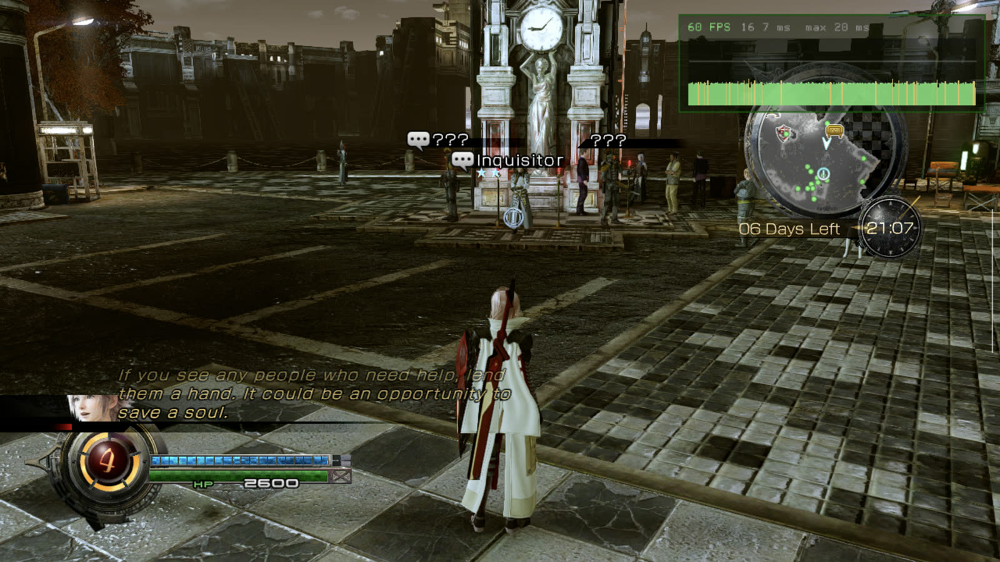</p>

<p align="center"><b><a href="https://github.com/Lazaer-YZY/ff13-lr-recomp/releases/latest/download/lr_thor_showcase_1080p60.mp4">▶ Watch the 2-minute video, both screens at 60 fps (MP4, 114 MB)</a></b> · <a href="https://github.com/Lazaer-YZY/ff13-lr-recomp/releases/latest/download/lr_thor_showcase_phone.mp4">smaller version (27 MB)</a></p>

> [!IMPORTANT]
> **No game code or data is included.** You need your own copy of the game (USA disc, see below). The APK you build contains code generated from your game's executable, so treat it like the game itself and don't share it.

## Highlights
- **Second screen on dual-screen devices** (AYN Thor and others): the active schema, ATB and abilities, enemy HP, EP and Libra weaknesses in battle; an area map that follows the camera in the field. Tap to switch schemata or map views. Costs no measurable performance.
- **Playable**: title, movies, field, battles, saves. Played from the prologue through Luxerion, Yusnaan and the Ark.
- **60 fps in gameplay out of the box**, with four frame-rate options from cool and quiet to smoothest (see [below](#four-frame-rate-options)). Cutscenes stay at the original 30.
- **720p, upscaled** to the screen with bilinear, AMD FSR 1.0 or AMD CAS; optional FXAA.
- **No shader stutter after the first start**: every shader the game uses is compiled in the background at the title screen and kept between sessions.
- **Runs well in the Thor's lowest power mode**: every number below is measured in AYN's *Standard* mode, not Performance or High Performance.
- **GPU driver bundled**: the open-source Turnip (Mesa) driver ships in the APK and is used automatically on Adreno.
- **One-command build**: `tools/quickstart.sh` sets up the toolchain, recompiles the game and installs it on your device.

## Screenshots
| | |
|---|---|
| 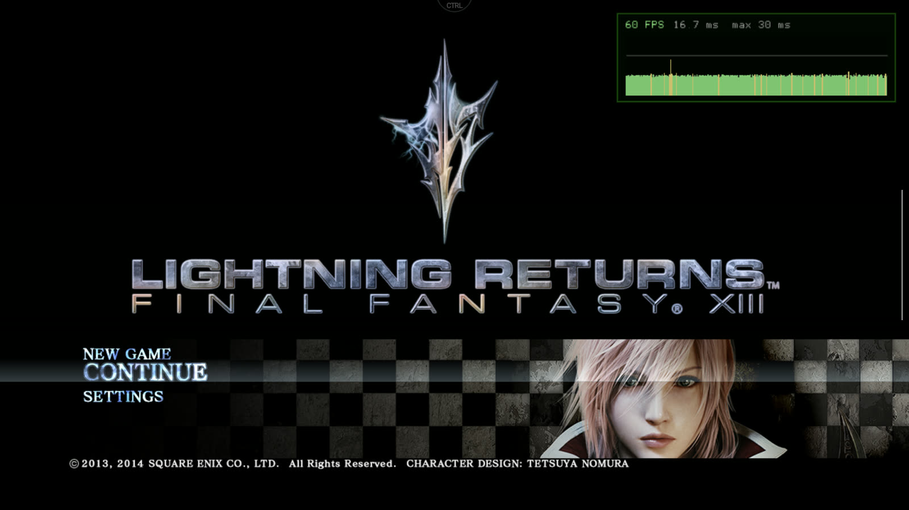 | 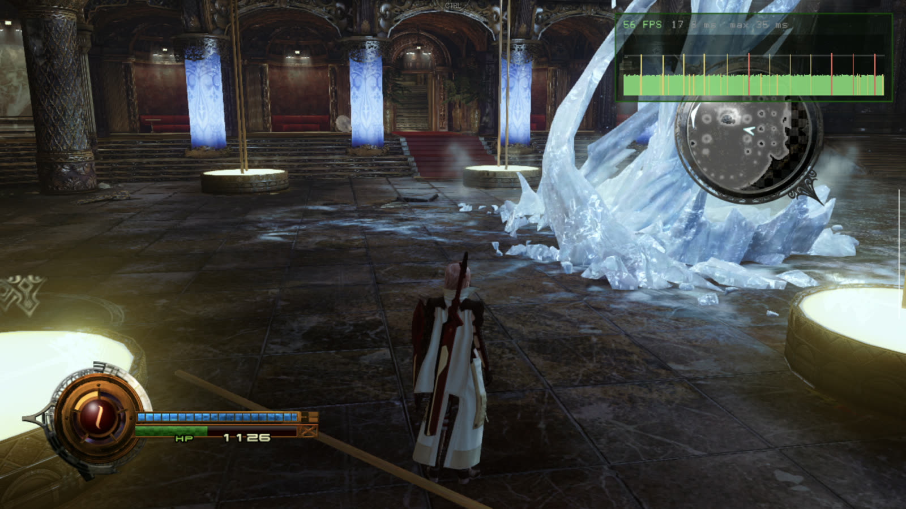 |
| 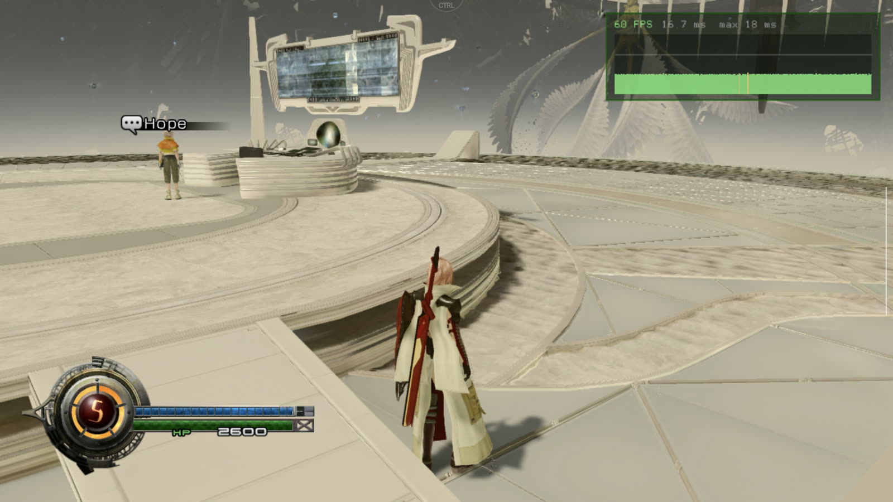 | |

Captured on the Thor at the panel's 1920x1080, with the app's optional performance overlay in the top right.

## Second screen (AYN Thor and other dual-screen devices)
On a device with a second display, the bottom screen becomes a live companion to the game. It reads the game's own state while you play, so it is always in step with the top screen.

| | |
|---|---|
| 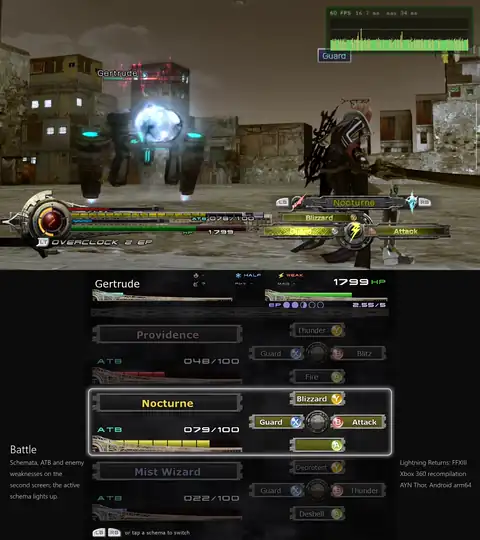 | 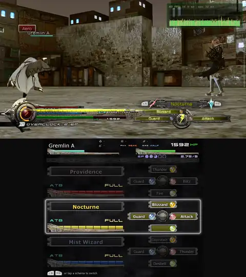 |
| **Battle**: all three schemata with their ATB gauges and abilities, the active one lit. Tap a schema to switch to it. | **Target**: the enemy's name, HP and Libra weaknesses (weak, half, resist), plus your EP. It follows target switches. |
| 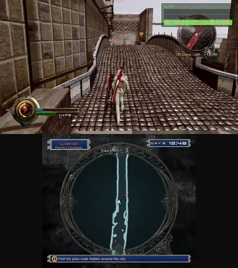 | 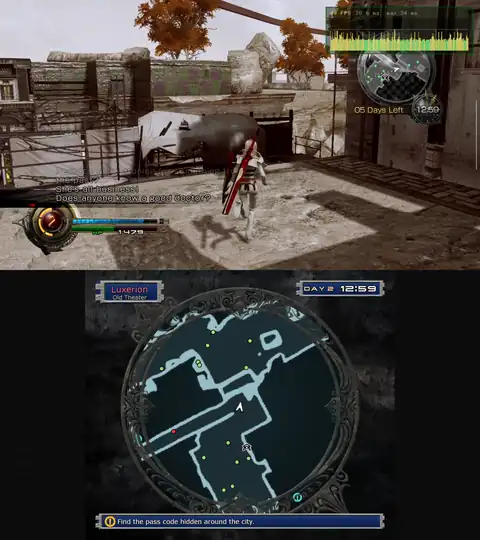 |
| **Field**: a close-up map that turns with the camera: enemies in red, people in green, shops and points of interest. | **Tap** to switch to the whole area map, with the day, the clock and the current objective. |

<p align="center">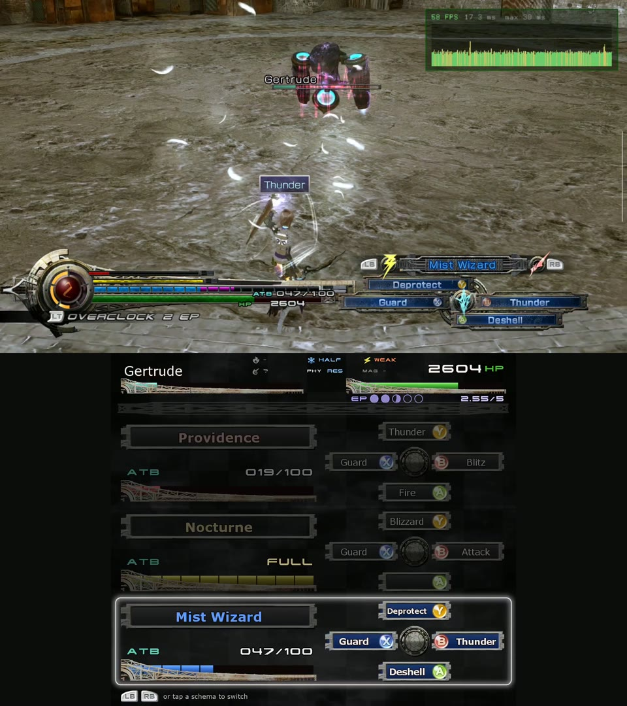 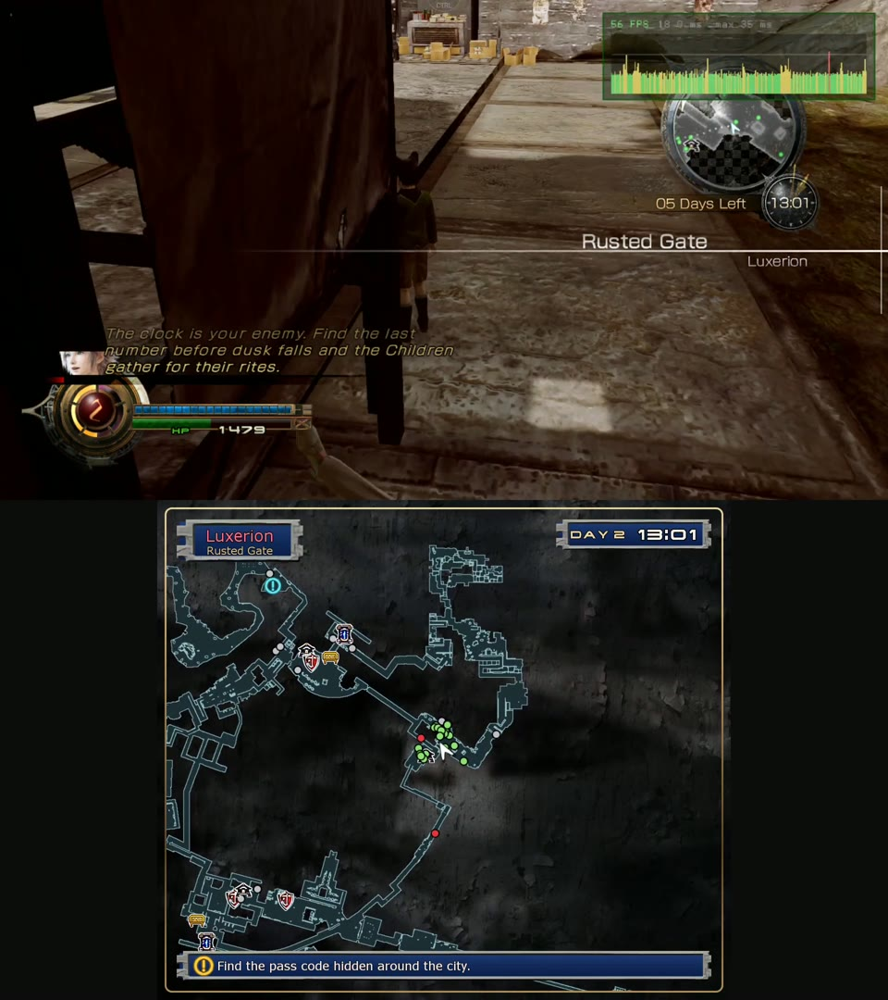</p>

- **Which devices:** the companion opens on any Android *presentation* display. That includes the bottom screen of dual-screen handhelds and, in principle, a second display attached over USB-C or HDMI. The layout scales to the display. It is tested on the AYN Thor (1240x1080 touch screen); other devices should work but are untested. Touch works on touch screens.
- **Cost:** measured on a 10-minute plaza walk at 60 fps: 1% low 44.4 fps with the second screen against 44.5 without, and +0.4 W. It draws on its own thread at 30-40 fps, never on the game's threads.
- **Setup:** none. The maps and screen artwork come from your game files. They are either built into the APK at build time or, if the APK has none, generated on the device at the first start (about two minutes, in the background). Turn the second screen off with CTRL > Second screen.
- **Font:** the bottom screen's text uses Verdana when the build machine has it (copied from Windows at build time, never in the repository). Otherwise it uses the system sans font.

## Performance on the AYN Thor
**Every number here is measured in the Thor's _Standard_ performance mode**, the lowest of its three (Standard, Performance, High Performance), with the fan on *Smart*, on the Snapdragon 8 Gen 2. Nothing is overclocked and no settings were changed for the tests. Measured with the scripts in `tools/`: 10-minute walks through Luxerion from the North Station plaza (the busiest town square), with the public build's default settings and the second screen on. CPU and GPU temperatures are the hottest sensor of each. Power is drawn over USB with a full battery, which equals what the device uses. No figure comes from a screen-recorded run, because recording both screens itself costs ~10 fps in 1% lows.

<p align="center">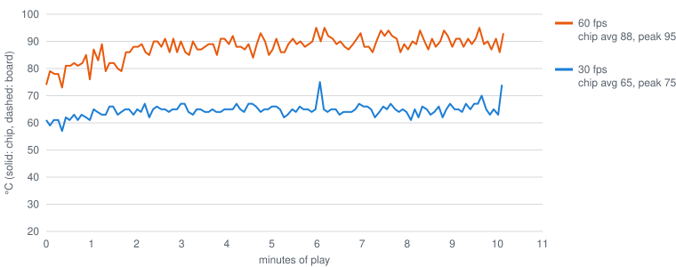</p>

| 10-minute Luxerion walk (2026-11-13) | 60 fps | 30 fps |
|---|---|---|
| Average frame rate | **58.8 fps** (36,032 frames) | **30.0 fps** (18,312 frames) |
| 1% low | 37.3 fps | 25.8 fps |
| Frames over 45 ms | 2 | 7 (battle starts) |
| Power, whole device, average | **9.6 W** | **5.8 W** |
| CPU temperature, average / peak | 92 / 97 °C | 71 / 77 °C |
| GPU temperature, average / peak | 77 / 81 °C | 59 / 61 °C |
| GPU clock / busy | 593 MHz / 80% | 401 MHz / 53% |

The walk is a worst case: non-stop running and turning, with no menus, cutscenes or pauses. The in-game clock passes midnight during the 10 minutes, so night-time enemies appear and both runs include a few short battles. The few frames over 45 ms are the battle-start transition. The CPU runs hotter than the GPU (the game's main thread and its effect workers keep the big cores busy). These are sensors *inside* the Snapdragon chip, which is what decides throttling; the case you hold runs far cooler. For comparison, a normal 9-minute play session, also at 60 fps:

| Normal play, 9 minutes | Average | Peak |
|---|---|---|
| Chip (hottest sensor) | 72 °C | 86 °C |
| Mainboard, next to the chip | 50 °C | 56 °C |
| Battery | 27 °C | 28 °C |

Other measurements from the project log ([`DECISIONS.md`](DECISIONS.md)):

| Scene | Result |
|---|---|
| Standing in the plaza, power by frame rate | 30 fps **6.2 W** · 40 fps **7.6 W** · 60 fps **9.1-10.4 W** |
| Warp cutscene, Ark to Nova Chrysalia (60 fps, 140 s) | 0.2% of frames over 45 ms, 1% low **48 fps** |
| Battles at 60 fps (prologue, four fights) | 59-60 fps, worst frame 20-27 ms, peak 78 °C |
| Battle start (the screen-shatter transition) | freeze cut from ~1 s to ~0.2 s |
| Second screen on vs off (10-minute plaza walk, 60 fps) | 1% low 44.4 vs 44.5 fps, +0.4 W |
| Start-up after the first run | title screen in ~20 s; GPU setup 0.45 s |
| First start after installing | ~16 s to compile the shaders used in play; the rest (~5 min) continues quietly at the title |

### Four frame-rate options
Choose under **CTRL > Frame rate** (and the *Smoother 60 fps* box). Cutscenes always run at the game's original 30 fps. The frame-rate choice applies to gameplay and menus. Measured on the Thor in Standard mode, standing in the plaza for 90 s, with whole-device power over USB.

| | **30 fps** | **40 fps** | **60 fps** (default) | **60 fps + Smoother 60** |
|---|---|---|---|---|
| Power, whole device | **6.2 W** | 7.6 W | 10.2-10.4 W | 9.1-10.1 W |
| Chip temperature, standing | ~70 °C | ~84 °C | 91-94 °C | about the same as 60 |
| How it holds | a locked 30 | steady 40, 1% low 35.5 fps | 1% low 27 fps when the GPU is maxed out | 1% low 37 fps in the same scene |
| Display | 60 Hz | 120 Hz panel mode, 3 refreshes per frame | 60 Hz | 120 Hz panel mode, 2 refreshes per frame |
| Best for | battery play: about 40% less power than 60, cool and quiet | a middle ground: much smoother than 30 for about 2.7 W less than 60 | the default: full smoothness on a charger or for shorter sessions | the smoothest: a late frame shows after 25 ms instead of 33 |

- **Why Smoother 60 helps:** at 60 Hz, a frame that misses its 16.7 ms slot waits for the next refresh and shows after 33 ms, a visible hitch. On the 120 Hz panel mode it shows after 25 ms. In the Ark warp cutscene that cut the frames held longer than 33 ms from 48 to 1. It draws about the same power, but one warp test ran warmer, so it stays a choice and is off by default.
- **40 fps and Smoother 60 need a screen with a 120 Hz mode** (the Thor has one). The app switches the panel to it on its own. On a 60 Hz-only screen, pick 30 or 60. If a start at 40 fps doesn't get going, the app falls back to 30 fps the next time.
- **On battery** the frame rate is the biggest lever: 30 fps uses about 6 W and 60 fps about 10 W. The 10-minute walk above shows the same gap while moving (5.8 W against 9.6 W).

## Install
### What you need
- **The game**: *Lightning Returns: Final Fantasy XIII*, USA Xbox 360 disc, dumped to an ISO from your own copy (title ID `5351081B`, media ID `4A99274C`, XEX version 0.0.0.8, no title update). Other regions need their own manifest and are untested.
- **A Windows 10/11 PC** with [Git for Windows](https://git-scm.com/download/win) and [Python 3](https://www.python.org/downloads/) (tick "Add to PATH"). No admin rights needed: everything else is downloaded portably into `C:\dev`. About **30 GB** free disk space.
- **An Android phone or handheld with a Snapdragon chip** (Adreno 6xx, 7xx or 8xx GPU; Snapdragon 8 Gen 2 or newer recommended; tested on the AYN Thor), about 8 GB free, and a controller (built-in or Bluetooth/USB; touch controls also work). Devices with Mali GPUs (Dimensity, Exynos, Tensor) are untested.
- **Time**: the first build compiles the recompiled game, which takes **one to several hours** on a laptop.

### Steps
1. **On the PC**, turn on Developer Mode (Settings > System > For developers) so Git can create symlinks.
2. **On the device**, turn on USB debugging (Settings > About > tap *Build number* 7 times, then Developer options > USB debugging), connect it with a USB cable and accept the prompt.
3. **In Git Bash**, clone the repository, then run the build with the path to your ISO:
   ```bash
   git -c core.symlinks=true clone https://github.com/Lazaer-YZY/ff13-lr-recomp.git /c/lr
   ```
   ```bash
   bash /c/lr/tools/quickstart.sh "/c/Users/you/Downloads/Lightning Returns (USA).iso" --install
   ```
   This downloads the toolchain, builds the recompiler, extracts your ISO, recompiles the game, builds the APK, installs it and copies the 7 GB of game files to the device. Steps that are already done are skipped, so if anything fails or you stop it, run the same command again. Leave out `--install` to only build the APK (`C:\lr\android\app\build\outputs\apk\debug\app-debug.apk`).
4. **Start the game** from the app drawer. The first start shows "Preparing shaders" at the title screen; wait for "Shaders ready" before starting and you won't get first-visit hitches.

**Game files without a USB copy:** install the APK on its own, put your ISO on the device, and on the first start (the *Game folder* page, also under CTRL) tap **Import from ISO…**. The app checks the disc's title ID and executable and extracts the game itself, in about 30 s on the Thor. Keep the app open until it finishes.

### Options (the CTRL button)
The game's own Settings menu is the Xbox 360 release's, unchanged. The port's options are behind the **CTRL** button at the top of the screen:

| Option | Choices (default first) | Notes |
|---|---|---|
| Frame rate | 60 · 40 · 30 fps in gameplay | Cutscenes stay at 30. 40 uses the 120 Hz panel mode. Applies at the next start. See [Four frame-rate options](#four-frame-rate-options). |
| Smoother 60 fps | off · on | 60 fps on the 120 Hz panel mode: a late frame shows after 25 ms instead of 33 ms. About the same power. |
| Upscaling | Bilinear · AMD FSR 1.0 · AMD CAS | FSR gives the sharpest edges. Restart required. |
| Anti-aliasing | Off · FXAA | FXAA runs at 720p before upscaling, so it softens the picture. |
| Performance overlay | off · on | fps and a frame-time graph. |
| Exact Xbox shader math | off · on | Slower. Only if something renders wrong (black or flashing pixels, broken lighting). |
| Touch controls | shown when no controller is connected | Size, opacity and layout are editable. |
| GPU driver | Stable Turnip v2 (bundled) | Installed and selected automatically on first start (Adreno 6xx/7xx/8xx; sysmem mode on Adreno 710/720/722). Other Turnip builds can be installed; Qualcomm's drivers are not supported. |
| Second screen | on | The bottom-screen companion on dual-screen devices (see above). |
| Debug logging | off | Writes frame and GPU statistics to the log, for reporting a problem. Costs ~4% CPU. |

**Buttons on AYN handhelds (Thor, Odin 2):** in the handheld's Nintendo button layout, face buttons act by position (bottom = A, right = B, left = X, top = Y) so they match the on-screen prompts. In Xbox mode nothing is swapped.

## What was optimised
The first version that ran (Xenia's Vulkan backend plus the recompiled game, as-is on a phone) managed about 16 fps in the opening and hit 95 °C. The main changes since, all measured on the Thor (details and numbers in [`DECISIONS.md`](DECISIONS.md)):

**Smoothness and frame pacing**
- **No compile stalls.** Pipelines are never compiled on the GPU thread: a missing one is built in the background while its draws are skipped for a frame or two. Every shader the game has used is precompiled at the title screen, most-used first (~16 s on a fresh install), and the shader, pipeline and driver caches persist. (Early on, the pipeline store was wiped at every start by a file-mode bug, and every battle opened with a stall.)
- **Frame pacing.** The vblank thread sleeps to a deadline, presents use FIFO instead of MAILBOX, and "Smoother 60" runs 60 fps on the 120 Hz panel mode so a late frame costs 8 ms instead of 16 ms (warp cutscene: late frames 48 to 1).
- **Battle starts.** The game compacts its GPU heap at every battle start (~10,000 small copy draws). Skipping repeated memory-watch work and coalescing barriers cut that freeze from ~1 s to ~0.2 s.

**GPU (the Thor is GPU-bound at 60 fps)**
- **Shader translation.** The Xbox's "0 × anything = 0" multiply emulation is off by default (-12% GPU time), branches in translated shaders become structured control flow that Adreno's compiler handles well (-22%), and texture sign handling is specialised per texture (-9%).
- **Render targets.** Resolves go straight from the render target into the game's memory on the GPU, unused ownership transfers and memory dumps are skipped, and vertex data is read through one buffer view of shared memory (-10% to -24% GPU time per scene).
- **Fences.** Zero-timeout fence polls block on Turnip; removing them and submitting work before the game's per-frame GPU wait cut a heavy Ark frame from 50 to 33 ms.

**CPU and heat**
- **Threads on the right cores.** Game threads are kept off the efficiency cores, and at 30 fps off the prime core too (slow battle frames 22% to 3%, CPU use -20%).
- **No spinning.** The game's effect workers spin-wait on each other; those loops now use real (futex) waits, which made frame pacing regular (frames held exactly two refreshes 66% to 96%) and lowered heat. The engine's job system runs short jobs on the calling thread instead of spinning.
- **Idle threads stay idle.** The UI thread wasted 84% of a core repainting a menu nobody saw (now 5%); the title screen went from 82 °C to 53 °C.
- **Faster recompiled code.** Recompiler flags that keep PowerPC registers in local variables (-9% game code), Clang profile-guided optimisation trained on real play (-6 to -10%), and code built for the Thor's ARMv8.2 cores.

Tried and dropped: half-precision shaders, forcing Turnip's tiled (GMEM) rendering, higher internal resolutions (2x is ~3x the GPU work), Qualcomm's own drivers (one hangs, one renders areas wrong), Android's performance hints (ADPF), and other Turnip builds (no gain).

## Building by hand
`tools/quickstart.sh` runs these steps; use them to redo a single step. The scripts expect the repository at `C:\lr` and the tools under `C:\dev` (if you cloned elsewhere, quickstart links `C:\lr` to your clone).

<details>
<summary>Manual build steps</summary>

1. **Toolchain** into `C:\dev`: LLVM 22.1.8, CMake 4.4.5, Ninja, xwin (MSVC headers and libraries), JDK 17, and the Android SDK with NDK 28.2.
   ```bash
   mkdir -p /c/dev/dl /c/dev/logs && cd /c/lr
   bash tools/fetch_toolchain.sh && bash tools/setup_sdks.sh all
   git submodule update --init thirdparty/libadrenotools
   ```
2. **ReXGlue SDK v0.10.1** (commit `546a082`) with this project's patches from `patches/rexglue-sdk/`:
   ```bash
   git -c core.symlinks=true clone --recurse-submodules https://github.com/rexglue/rexglue-sdk.git /c/lr/sdk/rexglue-sdk
   cd /c/lr/sdk/rexglue-sdk && git checkout -b lr-android 546a082
   git -c user.name=you -c user.email=you@example.com am /c/lr/patches/rexglue-sdk/*.patch
   ```
   If a later build fails with `lzxd.c:1:1: error: expected identifier`, the symlinks were checked out as text files: `bash /c/lr/tools/fix_symlinks.sh /c/lr/sdk/rexglue-sdk`.
3. **Recompiler for the PC** (installs `rexglue` into `C:\dev\rexglue`): `cd /c/lr && bash tools/build_sdk_host.sh all`
4. **Runtime for Android** (installs into `C:\dev\rexglue-android`):
   ```bash
   source /c/lr/tools/env.sh && cd /c/lr/sdk/rexglue-sdk && scripts/configure_android.sh
   cmake --build out/build/android-arm64 --target install --parallel 8
   ```
5. **Game files**: `cd /c/lr && python -I tools/xdvdfs.py /path/to/your.iso extract "Input - Data/extracted"`
6. **Recompile the game** (~5 minutes), then apply the project's fix-ups (needed after every codegen):
   ```bash
   source /c/lr/tools/env.sh && cd /c/lr
   rexglue codegen lr_manifest.toml --ignore-stamp && python -I tools/patch_generated.py
   ```
7. **Build the APK**:
   ```bash
   echo "sdk.dir=C:/dev/android-sdk" > /c/lr/android/local.properties
   cd /c/lr && bash tools/build_android.sh configure build stage apk
   ```
8. **Install and copy the game files** (set `LR_ADB_SERIAL` if several devices are connected):
   ```bash
   bash tools/build_android.sh install && bash tools/push_game_data.sh "C:/lr/Input - Data/extracted"
   ```
   The files go to `Android/data/com.lrrecomp.android/files/game/` (`default.xex` and `weiss_data/`); copying that folder over USB with a file manager works too.

The project's profile-guided optimisation data (`out/pgo/lr.profdata`) is derived from the game and not in the repository, so your build's game code is a few percent slower unless you collect your own profile (see "PGO" in `DECISIONS.md`).
</details>

## Shader cache
Everything compiled is kept in `files/cache/shaders/shareable/` on the device:

| File | What it holds | Shareable |
|---|---|---|
| `5351081B.xsh` | the game's shaders as the game loaded them | yes, with people who own the game (it contains game code) |
| `5351081B.fbo.vk.xpso` | which shader and render-state combinations were used | yes |
| `5351081B.vk.pipelinecache` | the driver's compiled GPU code | no; it only fits the same GPU and driver |

The background precompile runs again only after an app update with new shader data or a GPU-driver change. To back up a cache, or merge in a friend's (Git Bash, device connected):
```bash
bash tools/shader_cache.sh pull
```
```bash
bash tools/shader_cache.sh push friend.zip
```

## Troubleshooting
- **Logs** are in `Android/data/com.lrrecomp.android/files/logs/lr.log`: `adb pull /sdcard/Android/data/com.lrrecomp.android/files/logs`
- **Hitches in new areas right after installing:** the background shader compile hadn't finished. Wait at the title for "Shaders ready" once.
- **Wrong colours, black or flashing pixels:** turn on CTRL > Exact Xbox shader math (shaders rebuild once).
- **Build fails after a codegen:** run `python -I tools/patch_generated.py`; it is needed after every `rexglue codegen`.
- **Several devices connected:** set `LR_ADB_SERIAL=<serial>` for the scripts.
- The scripts end every device step by stopping the game and putting the device to sleep, so expect the screen to go off after an install or a copy.

## Repository layout
- `src/`: game-side code (hooks, Android glue) compiled with the recompiled C++.
- `android/`: the Android app (Gradle): activities, CTRL dialog, GPU driver store, touch controls, the second-screen companion and the ISO import.
- `docs/`: notes on how the shader pipeline works and on the game memory the second screen reads (`dual_screen_*_re.md`).
- `patches/rexglue-sdk/`: this project's 108 changes to the ReXGlue SDK (Android port, renderer, shaders, performance), as `git am` patches.
- `tools/`: build, install, benchmark and analysis scripts. `lr_manifest.toml`: the recompiler's manifest for this executable.
- [`DECISIONS.md`](DECISIONS.md), [`REFERENCE_NOTES.md`](REFERENCE_NOTES.md): dated log of every choice and measurement, research notes on the projects listed below.
- Git-ignored: `Input - Data/` (your game files), `generated/` (recompiled C++), `sdk/`, `refs/`, `out/`.

## References and credits
Ordered by how much this port relies on them.

1. **[ReXGlue SDK](https://github.com/rexglue/rexglue-sdk)** (BSD-style), derived from **[Xenia](https://xenia.jp)**: the recompiler, runtime and Vulkan GPU emulation everything is built on. This project carries 108 patches on v0.10.1.
2. **[lr-ffxiii-port](https://github.com/leftisthominid/lr-ffxiii-port)** by leftisthominid (GPL-3.0): an earlier ReXGlue port of this exact title. Its function analysis set, codegen flags and runtime hooks (including the movie/graphics-interrupt deadlock fix) were the starting point.
3. **[Lost Odyssey Recomp](https://github.com/freefrank/LostOdysseyRecomp)** (GPL-3.0): the Android app layer (activities, GPU driver store, game folder, touch overlay, Turnip loading) is adapted from it; also ideas for render-target handling and thread placement on phones.
4. **[Turnip / Mesa](https://docs.mesa3d.org/drivers/freedreno.html)** (MIT), packaged by **[whitebelyash](https://github.com/whitebelyash/AdrenoToolsDrivers)** (Stable Turnip v2): the bundled GPU driver, loaded with **[libadrenotools](https://github.com/bylaws/libadrenotools)** (BSD-2).
5. **[Lighthing-Recomp](https://github.com/naubasurq/Lighthing-Recomp)** (MIT): Final Fantasy XIII on the same engine; project layout, the codegen workflow and the texture `exp_adjust` fix.
6. **[SDL3](https://github.com/libsdl-org/SDL)** (zlib): windowing, input, audio and app lifecycle on Android.
7. **[Xendroid+](https://github.com/phforner0/Xendroid-Plus)** and **[XeniOS](https://github.com/xenios-jp/XeniOS)**: ideas for mobile GPUs (texture sign specialisation, direct host resolve), re-implemented here.
8. **[UnleashedRecomp](https://github.com/hedge-dev/UnleashedRecomp)**, **[XenonRecomp](https://github.com/hedge-dev/XenonRecomp)**, **[XenosRecomp](https://github.com/hedge-dev/XenosRecomp)**: reference implementations of static and shader recompilation (register flags, shader precompile approach).
9. **[xenia-edge](https://github.com/has207/xenia-edge)**, **[Theft4](https://github.com/KoreanSeats1/Theft4)** and X360-Mobile: corroborating notes on resolve and transfer optimisations.

## Licence
GNU GPL v3 (see [`LICENSE`](LICENSE)). *Lightning Returns: Final Fantasy XIII* is © Square Enix. This project is not affiliated with Square Enix; no game code or data is distributed here.
